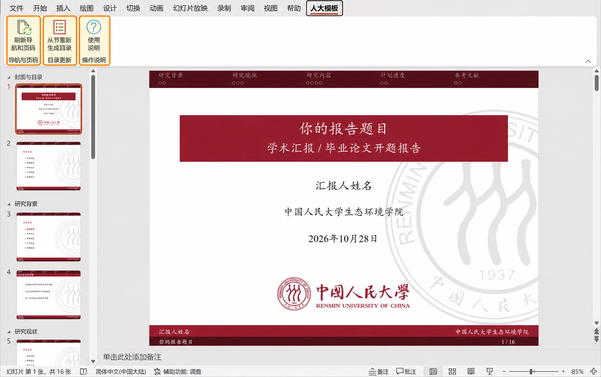
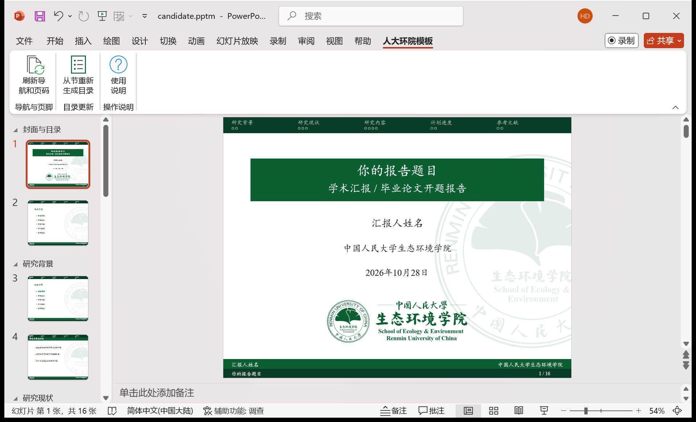

# RUC PowerPoint Template (Embedded Macros)

从人大 LaTeX Beamer 模板改编的可编辑 PowerPoint，提供**人大通用版**和**生态环境学院版**。两套模板均内置章节导航、圆点跳转、目录更新、页脚同步和页码刷新功能，适用于 Windows 版 Microsoft PowerPoint。

**[下载最新发布包 · Releases](https://github.com/Hao-jieDai/RUC-PowerPoint-Template-Embedded-Macros/releases/latest)**

## 选择与下载

| 模板 | 配色与标志 | 编辑底稿 | 展示示例 | 使用说明 |
| --- | --- | --- | --- | --- |
| 人大通用版 | 人大红色与校徽 | [下载 PPTM](https://github.com/Hao-jieDai/RUC-PowerPoint-Template-Embedded-Macros/raw/refs/heads/main/templates/ruc/%E4%BA%BA%E5%A4%A7PPT%E6%A8%A1%E6%9D%BF.pptm) | [下载 PPTX](https://github.com/Hao-jieDai/RUC-PowerPoint-Template-Embedded-Macros/raw/refs/heads/main/templates/ruc/%E4%BA%BA%E5%A4%A7PPT%E6%A8%A1%E6%9D%BF_%E7%A4%BA%E4%BE%8B.pptx) | [查看说明](templates/ruc/README.md) |
| 生态环境学院版 | 环院绿色与院标 | [下载 PPTM](https://github.com/Hao-jieDai/RUC-PowerPoint-Template-Embedded-Macros/raw/refs/heads/main/templates/ecology/%E4%BA%BA%E5%A4%A7%E7%8E%AF%E9%99%A2PPT%E6%A8%A1%E6%9D%BF.pptm) | [下载 PPTX](https://github.com/Hao-jieDai/RUC-PowerPoint-Template-Embedded-Macros/raw/refs/heads/main/templates/ecology/%E4%BA%BA%E5%A4%A7%E7%8E%AF%E9%99%A2PPT%E6%A8%A1%E6%9D%BF_%E7%A4%BA%E4%BE%8B.pptx) | [查看说明](templates/ecology/README.md) |

上表直接下载仓库中的对应文件。完整压缩包包含编辑底稿、展示示例、宏源码、预览图和使用说明；在 Releases 中按下面的文件名选择：

- **人大通用版**：`RUC-PowerPoint-Template-Embedded-Macros.zip`
- **生态环境学院版**：`RUC-Ecology-PowerPoint-Template-Embedded-Macros.zip`

### 人大通用版预览

### 生态环境学院版预览

## 如何使用

1. **保留原始 `.pptm` 底稿，复制一份副本开始编辑。**
2. 用 Windows 版 Microsoft PowerPoint 打开副本，确认文件来源可信后启用宏。
3. 修改封面的题目、姓名和学院，编辑内容，并按需要增删或移动幻灯片。
4. 用 PowerPoint 左侧缩略图中的“节”组织章节；需要修改目录时，先修改节名称或调整节。
5. 在“人大模板”或“人大环院模板”选项卡中点击相应按钮，再保存 `.pptm`。
6. **展示前另存一份 `.pptx`**，用于教室电脑或其他电脑放映；后续修改继续使用 `.pptm`。

`.pptm` 是包含宏的编辑底稿；`.pptx` 是不含宏的通用展示文件。已保存的圆点和目录链接在放映时仍可点击，放映电脑无需安装插件或启用宏。但在 `.pptx` 中增删页面后，圆点数量和总页数不会重新计算。

## 三个宏按钮

| 按钮 | 什么时候使用 | 作用 |
| --- | --- | --- |
| **刷新导航和页码** | 修改封面、增删或移动页面、修改节名称后 | 同步封面题目、姓名和学院到所有页脚；更新顶部章节标题、圆点数量、跳转链接及页码。 |
| **从节重新生成目录** | 修改节名称、数量或顺序后，需要重建目录时 | 按当前节生成总目录和章节目录，突出显示当前章节，并刷新导航、页脚和页码。 |
| **使用说明** | 编辑时需要查看操作提示 | 显示常用操作说明。 |

宏通过点击按钮执行，**不会在每次编辑后自动运行**。普通刷新会保留手工编辑的目录文字和位置；重新生成目录会替换模板所管理目录条目的手工文字、位置和格式，点击前会要求确认。完整说明见各模板文件夹中的 README。

## 文件与源码

- [`templates/ruc`](templates/ruc)：人大通用版，包含 PPTM、PPTX、宏源码、预览图及 README。
- [`templates/ecology`](templates/ecology)：生态环境学院版，包含 PPTM、PPTX、宏源码、预览图及 README。
- [人大通用版宏源码](templates/ruc/人大模板_宏源码.bas) · [生态环境学院版宏源码](templates/ecology/人大环院模板_宏源码.bas)

`.pptm` 已经内置宏，无需另行导入源码。可按 `Alt+F11` 查看内置 VBA，也可直接阅读 `.bas` 文件。网络下载文件若被 Office 阻止运行宏，请参阅微软的[网络文件宏阻止说明](https://learn.microsoft.com/en-us/microsoft-365-apps/security/internet-macros-blocked)，并遵循所在学校或单位的管理要求。无需降低全局宏安全等级或开启“信任对 VBA 工程对象模型的访问”。

## 模板来源

本项目根据 [RUC Beamer Theme](https://www.overleaf.com/latex/templates/ruc-beamer-theme/ssryphkjpyjt) 改编，将原 LaTeX 模板的配色、校徽、背景与版式转为可编辑 PowerPoint，并加入内置 VBA 宏。生态环境学院版在此基础上使用环院院标与绿色配色。

- 原模板作者：Wenquan Wu。
- 原模板仓库：[GohUnTsuan/RUC-Beamer-Theme](https://github.com/GohUnTsuan/RUC-Beamer-Theme)。
- 原模板许可：[CC BY 4.0](https://creativecommons.org/licenses/by/4.0/)。分享改编版本时，请保留来源、许可及改编说明。
- 原项目亦致谢了 Jiayi Weng 的 [THU-Beamer-Theme](https://github.com/Trinkle23897/THU-Beamer-Theme)。
